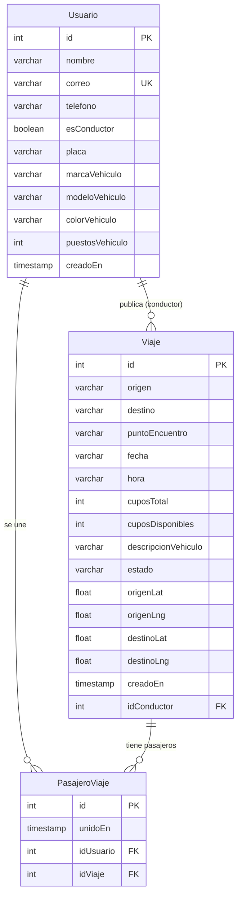

# Laboratorio — Modelo de datos RideUJAP

**Proyecto:** RideUJAP (carpooling comunidad UJAP)  
**Objetivo:** modelar el corazón de datos del proyecto

---

## 1. Obligatorio — Diagrama entidad-relación (PostgreSQL)

### Diagrama (igual que el mostrado en clase / chat)

Basado en `rideujap-create-tables.sql` — todas las columnas del script:



### Entidades y atributos clave

| Entidad | Atributos clave | PK |
|---|---|---|
| **Usuario** | nombre, correo, telefono, esConductor, placa (si conductor) | `id` |
| **Viaje** | origen, destino, fecha, hora, cuposTotal, cuposDisponibles, estado, idConductor | `id` |
| **PasajeroViaje** | unidoEn, idUsuario, idViaje | `id` |

### Relaciones

| De | A | Cardinalidad | Significado |
|---|---|---|---|
| Usuario | Viaje | **1 : N** | Un conductor publica muchos viajes; un viaje tiene un solo conductor |
| Usuario | PasajeroViaje | **1 : N** | Un usuario puede unirse a muchos viajes |
| Viaje | PasajeroViaje | **1 : N** | Un viaje tiene muchos pasajeros unidos |
| Usuario ↔ Viaje | (vía PasajeroViaje) | **N : M** | Muchos pasajeros ↔ muchos viajes |

### Diagrama (pegar en [dbdiagram.io](https://dbdiagram.io))

```dbml
Table Usuario {
  id int [pk, increment]
  nombre varchar [not null]
  correo varchar [unique, not null]
  telefono varchar
  esConductor boolean [default: false]
  placa varchar
}

Table Viaje {
  id int [pk, increment]
  origen varchar [not null]
  destino varchar [not null]
  puntoEncuentro varchar
  fecha varchar [not null]
  hora varchar [not null]
  cuposTotal int [not null]
  cuposDisponibles int [not null]
  descripcionVehiculo varchar
  estado varchar [default: 'disponible']
  idConductor int [not null, ref: > Usuario.id]
}

Table PasajeroViaje {
  id int [pk, increment]
  unidoEn timestamp [default: `now()`]
  idUsuario int [not null, ref: > Usuario.id]
  idViaje int [not null, ref: > Viaje.id]

  indexes {
    (idUsuario, idViaje) [unique]
  }
}
```

### Diagrama textual (si lo dibujan a mano)

```
┌──────────────┐         1          ┌──────────────┐
│   Usuario    │───────────────────<│    Viaje     │
│--------------│   publica          │--------------│
│ PK id        │   (conductor)      │ PK id        │
│ correo UK    │                    │ FK idConductor│
│ esConductor  │                    │ origen       │
│ placa        │                    │ destino      │
└──────┬───────┘                    │ fecha, hora  │
       │                            │ cupos...     │
       │ 1                          └──────┬───────┘
       │                                   │ 1
       │                                   │
       │            ┌──────────────────────┘
       │            │
       │ N          │ N
       ▼            ▼
┌─────────────────────────┐
│     PasajeroViaje       │
│-------------------------│
│ PK id                   │
│ FK idUsuario → Usuario  │
│ FK idViaje   → Viaje    │
│ unidoEn                 │
│ UNIQUE(idUsuario,idViaje)│
└─────────────────────────┘
```

---

## 2. Obligatorio — Script SQL (`CREATE TABLE`)

Al menos dos entidades relacionadas, con **PRIMARY KEY** y **FOREIGN KEY**:

```sql
CREATE TABLE "Usuario" (
  "id"              SERIAL PRIMARY KEY,
  "nombre"          VARCHAR(120) NOT NULL,
  "correo"          VARCHAR(180) NOT NULL UNIQUE,
  "telefono"        VARCHAR(40)  NOT NULL DEFAULT '',
  "esConductor"     BOOLEAN      NOT NULL DEFAULT FALSE,
  "placa"           VARCHAR(20),
  "marcaVehiculo"   VARCHAR(60),
  "modeloVehiculo"  VARCHAR(60),
  "colorVehiculo"   VARCHAR(40),
  "puestosVehiculo" INTEGER,
  "creadoEn"        TIMESTAMP    NOT NULL DEFAULT NOW()
);

CREATE TABLE "Viaje" (
  "id"                  SERIAL PRIMARY KEY,
  "origen"              VARCHAR(200) NOT NULL,
  "destino"             VARCHAR(200) NOT NULL,
  "puntoEncuentro"      VARCHAR(200),
  "fecha"               VARCHAR(20)  NOT NULL,
  "hora"                VARCHAR(10)  NOT NULL,
  "cuposTotal"          INTEGER      NOT NULL,
  "cuposDisponibles"    INTEGER      NOT NULL,
  "descripcionVehiculo" VARCHAR(200) NOT NULL,
  "estado"              VARCHAR(40)  NOT NULL DEFAULT 'disponible',
  "origenLat"           DOUBLE PRECISION,
  "origenLng"           DOUBLE PRECISION,
  "destinoLat"          DOUBLE PRECISION,
  "destinoLng"          DOUBLE PRECISION,
  "creadoEn"            TIMESTAMP    NOT NULL DEFAULT NOW(),
  "idConductor"         INTEGER      NOT NULL,
  CONSTRAINT "Viaje_idConductor_fkey"
    FOREIGN KEY ("idConductor") REFERENCES "Usuario"("id")
);

CREATE TABLE "PasajeroViaje" (
  "id"        SERIAL PRIMARY KEY,
  "unidoEn"   TIMESTAMP NOT NULL DEFAULT NOW(),
  "idUsuario" INTEGER   NOT NULL,
  "idViaje"   INTEGER   NOT NULL,
  CONSTRAINT "PasajeroViaje_idUsuario_fkey"
    FOREIGN KEY ("idUsuario") REFERENCES "Usuario"("id"),
  CONSTRAINT "PasajeroViaje_idViaje_fkey"
    FOREIGN KEY ("idViaje") REFERENCES "Viaje"("id"),
  CONSTRAINT "PasajeroViaje_usuario_viaje_unique"
    UNIQUE ("idUsuario", "idViaje")
);
```

**Lectura rápida para la defensa oral:**
- `Usuario.id` → PK.
- `Viaje.idConductor` → FK a `Usuario` (relación 1:N conductor–viajes).
- `PasajeroViaje` une usuario y viaje (N:M) con dos FK y UNIQUE para no repetir la misma unión.

---

## 3. Bonus — NoSQL (MongoDB-style)

**Qué no encaja bien solo en tablas:** el **historial de notificaciones / eventos de la app** (alguien se unió, viaje cancelado, recordatorio de salida). Son documentos heterogéneos, crecen mucho y se consultan por usuario + fecha, no con JOINs rígidos.

### Colección: `notificaciones`

```json
{
  "_id": "66f1a2b3c4d5e6f789012345",
  "idUsuario": 12,
  "tipo": "pasajero_unido",
  "titulo": "Nuevo pasajero en tu ruta",
  "mensaje": "Andrea Pérez se unió a San Diego → Campus UJAP",
  "leida": false,
  "creadoEn": "2026-09-30T19:45:00.000Z",
  "payload": {
    "idViaje": 42,
    "idPasajero": 7,
    "origen": "San Diego",
    "destino": "Campus UJAP",
    "cuposDisponibles": 2
  },
  "canal": ["in_app", "email"],
  "meta": {
    "app": "RideUJAP",
    "version": "1.0"
  }
}
```

**Por qué NoSQL aquí:** el `payload` cambia según el `tipo` (unión, cancelación, OTP, chat). En SQL harían columnas nullable o tablas por tipo; en documento JSON cada evento lleva solo lo que necesita.

---

## Cómo entregar en clase

1. Captura o dibujo del ER (o export PNG desde dbdiagram.io).  
2. Este SQL (punto 2) en un `.sql` o pegado en el informe.  
3. (Bonus) el JSON de notificaciones.

Archivo listo para la clase: `docs/LAB-MODELO-DATOS-RIDEUJAP.md`
